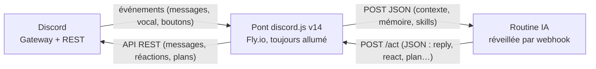

# cûm slayer

Un agent Discord libre, drôle et un peu arrogant, conçu pour agir avec des outils plutôt qu’avec des scripts figés.

Le bot **cûm slayer** (`cûm slayer`, `cum slayer`, `slayer`) vit sur le serveur **Le Royaume**. Il parle comme un pote, réagit aux messages, se souvient des gens, peut poser une réaction, rejoindre un vocal, et — quand on lui demande d’agir sur le serveur — prépare un plan que le demandeur doit confirmer lui-même.

> L’idée n’est pas d’écrire du code pour contrôler l’IA, c’est de lui donner des outils pour résoudre le problème.

## Motifs clés

- **Déclenché par presque tout** — mention, surnom, mot-clé, réponse à un de ses messages, message d’un autre bot, tâche planifiée (roast du jour), activité vocale.
- **Piloté par des outils** — la routine IA n’exécute pas l’API Discord à la main : elle appelle `scripts/act.sh` (et les autres outils) avec un JSON.
- **Voit les photos** — si on le mentionne, l’appelle par son nom, lui répond ou lui écrit en DM, le payload inclut jusqu’à 4 images ; la routine les télécharge avec `scripts/img.sh`.
- **Agit librement** — peu de contraintes de style, parfois un peu trop franc. Les vraies limites sont dans le code, pas dans le prompt.
- **Comportement naturel** — il s’intègre au salon, réagit comme un membre, pas comme un assistant.

## Personnalité

Assurance à fond, répartie, un brin arrogant — mais pas susceptible : il encaisse les moqueries avec classe. Un vrai manque de respect, il le fait savoir. Ton de pote, phrases courtes, trash et humour adulte autorisés entre adultes.

Limites qui restent, même pour lui :

- rien de sexuel impliquant des mineurs ;
- pas de haine fondée sur l’origine, la religion, l’orientation ou le handicap ;
- pas de vraies menaces, pas d’incitation au suicide, pas de doxxing.

## Architecture

Le pont Discord tourne 24 h/24 (Fly.io, région Paris). Il se contente de rester connecté à la passerelle Discord, de décider s’il faut réagir, et de transmettre le contexte à une **routine IA joignable par webhook**. La routine répond en rappelant le pont via HTTP (`POST /act`), et le pont parle à Discord par l’API REST.



Un seul processus gateway à la fois : Discord déconnecte le second s’il y en a deux.

## Fonctionnalités

| Sujet | Ce que ça fait |
| --- | --- |
| **Déclencheurs & périmètre** | Dans la catégorie **AGENTS** : mention, surnom, mot-clé `cum`/`cûm`, réponse au bot. Ailleurs : `@` explicite ou réponse à un message du bot. |
| **Règlement AGENTS** | Appliqué en code (`src/scope.js`, `src/perms.js`, `src/mod.js`), pas seulement par le modèle. Voir [docs/reglement-securite.md](docs/reglement-securite.md). |
| **Plans Confirmer / Annuler** | Toute action qui crée, modifie ou supprime quelque chose est d’abord postée comme un plan. Seul le demandeur peut cliquer, pendant 10 minutes. |
| **Permissions** | Calcul déterministe (propriétaire, Administrateur, rôles, overwrites, timeout). Les actions d’admin restent réservées au créateur. |
| **Mémoire & skills** | Notes durables par utilisateur, et règles déclenchées par un motif. Voir [docs/memoire-skills.md](docs/memoire-skills.md). |
| **Mémoire par utilisateur** | Historique des derniers messages de chaque membre + notes courtes, injectés en contexte de fond (utilisé rarement, pour viser juste). Voir [docs/memoire-par-user.md](docs/memoire-par-user.md). |
| **Réactions** | Une réaction sur le message auquel il répond, pour exprimer une émotion. |
| **Roast du jour** | Tous les soirs entre 18 h et 22 h (heure de Paris), une pique originale à quelqu’un avec qui il a déjà parlé dans AGENTS. |
| **Vocal automatique** | Rejoint le salon vocal le plus rempli (micro ouvert, casque coupé), part quand il n’y a plus personne. |
| **Présence** | Statuts rotatifs (`data/statuses.json`) dans le fuseau Europe/Paris. |
| **Anti-boucle bots** | Au plus 5 réponses consécutives à des bots par salon, puis silence (pas d’appel à l’IA) jusqu’à ce qu’un humain écrive ou 20 s d’inactivité. |
| **Watchdog** | En local : superviseur + chien de garde + gardien qui se relancent entre eux. Sur Fly : healthcheck `/health`. |

## Démarrage rapide

```bash
git clone <url-du-depot> cum-slayer
cd cum-slayer
npm install
cp .env.example .env   # remplir DISCORD_BOT_TOKEN, ROUTINE_WEBHOOK_URL, ROUTINE_WEBHOOK_KEY
set -a && source .env && set +a
npm test               # tests hors-ligne (sans Discord)
npm start              # pont seul
# ou, avec relance automatique :
./scripts/start.sh
./scripts/stop.sh
```

Le déploiement 24 h/24 sur Fly.io est décrit dans [docs/deploiement-fly.md](docs/deploiement-fly.md).

## Structure du projet

```
├── AGENTS.md                 # Règles pour le bot et pour les agents de dev
├── README.md
├── src/                      # Code du pont (discord.js v14)
│   ├── bridge.js             # Entrée : gateway, déclencheurs, présence, vocal
│   ├── config.js             # Identifiants et chemins, surchargés par l’env
│   ├── scope.js              # Périmètre AGENTS, déclencheurs, anti-boucle, DM
│   ├── perms.js              # Calcul des permissions Discord
│   ├── mod.js / act.js       # Outils serveur + plans à confirmer
│   ├── act_http.js           # API HTTP /health, /act, /run
│   ├── roast.js              # Roast du jour
│   ├── images.js             # Collecte des photos pour le payload
│   ├── restart.js            # Commande slash /restart (créateur uniquement)
│   ├── slash.js              # /classement (local) et /fiche (routine)
│   └── memory.js, skills.js, usermem.js, …
├── scripts/                  # Outils appelés par la routine (act.sh, img.sh, …)
├── deploy/fly/               # Fly.io (Dockerfile, fly.toml, deploy-fly.sh)
├── docs/                     # Explications détaillées
├── prompts/ROUTINE_PROMPT.fr.md
├── data/                     # État runtime (exemples fournis, pas de données perso)
├── assets/                   # Avatar et bannières
└── tests/
```

## Documentation

| Document | Contenu |
| --- | --- |
| [docs/architecture.md](docs/architecture.md) | Vue d’ensemble, flux, responsabilités |
| [docs/pont.md](docs/pont.md) | Fonctionnement du pont (gateway, payload, outils) |
| [docs/routine.md](docs/routine.md) | Routine IA et prompt (version publiable) |
| [docs/reglement-securite.md](docs/reglement-securite.md) | Règlement AGENTS, plans, limites |
| [docs/deploiement-fly.md](docs/deploiement-fly.md) | Hébergement 24 h/24 sur Fly.io |
| [docs/configuration.md](docs/configuration.md) | Variables d’environnement |
| [docs/memoire-skills.md](docs/memoire-skills.md) | Mémoire utilisateurs et skills |
| [docs/memoire-par-user.md](docs/memoire-par-user.md) | Historique + notes par membre, outil `user`, backfill, garde-fous |
| [docs/roast-du-jour.md](docs/roast-du-jour.md) | Sélection, horaire, style |
| [docs/vocal.md](docs/vocal.md) | Auto-voice et présence |
| [docs/faq.md](docs/faq.md) | Dépannage |

## Développement

Le projet est pensé pour être modifié avec l’aide d’une IA, tout en gardant un humain aux commandes. Les consignes pour les agents de code sont dans [`AGENTS.md`](AGENTS.md) : rester pragmatique, faire passer toute nouvelle action Discord par les gardes (`scope.js`, workflow de plan), ne jamais commiter de secret.

```bash
npm run check      # syntaxe
npm test           # tests hors-ligne
npm run test:live  # tests qui parlent à Discord (jeton requis)
```

## Licence

[MIT](LICENSE) © Baptiste Martin
