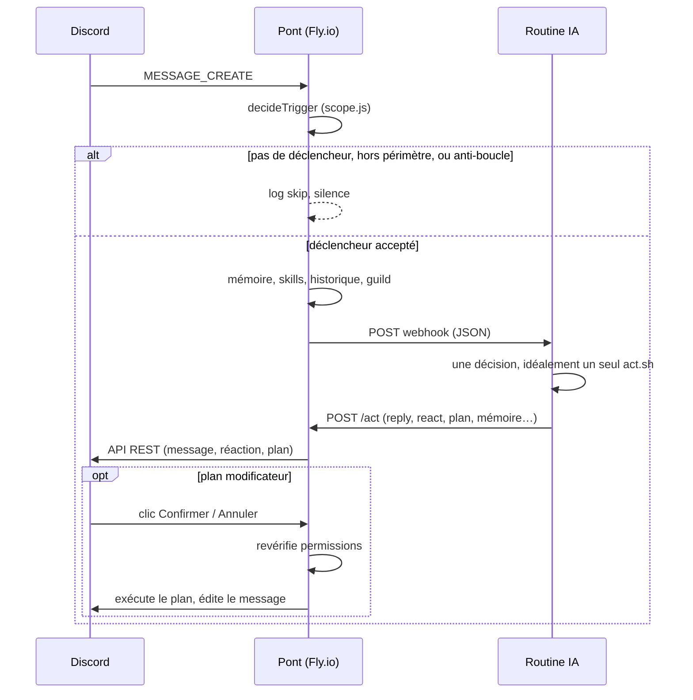

# Architecture

cûm slayer est découpé en deux parties clairement séparées.

1. **Le pont** (`src/bridge.js`, discord.js v14) reste connecté en permanence à la passerelle Discord. Il décide si un événement doit réveiller l’IA, construit un payload JSON, et expose une petite API HTTP (`/health`, `/act`, `/run`) pour que la routine puisse agir.
2. **La routine IA** est un agent externe, réveillé uniquement par un webhook. Elle lit le payload, réfléchit, et n’agit sur Discord qu’en appelant les scripts du pont (`scripts/act.sh`, ou `POST /act` quand elle tourne ailleurs).

Cette séparation permet au bot de rester en ligne 24 h/24 même quand la routine est à l’arrêt, et d’empêcher le modèle d’appeler l’API Discord directement.

## Flux d’un message

## Responsabilités

| Couche | Fait | Ne fait pas |
| --- | --- | --- |
| Pont | Gateway, scope, rate limits, payload, HTTP `/act`, exécution des plans confirmés, vocal, roast, présence, watchdog | Décider du texte, « comprendre » un ordre, contourner les gardes |
| Routine | Lire le payload, rédiger la réponse, choisir une réaction, proposer un plan, enrichir la mémoire | Appeler Discord sans passer par les scripts, révéler secrets ou infra |
| Code de garde (`scope`, `perms`, `mod`) | Périmètre, permissions réelles, confirmation, limites dures | Faire confiance au modèle |

## Un seul gateway

Discord n’accepte qu’une session gateway par jeton. Deux processus (par exemple un pont local et un pont Fly) se chassent l’un l’autre. En production le pont tourne uniquement sur Fly.io, région `cdg` (Paris), une seule machine, 256 Mo.

## Données persistantes

Sur Fly, le répertoire `data/` est un volume. Il contient la mémoire, les skills, les interactions, les contacts du roast, les plans en attente et le heartbeat. Ces fichiers ne sont **pas** dans le dépôt (voir les exemples `data/*.example.json`).
